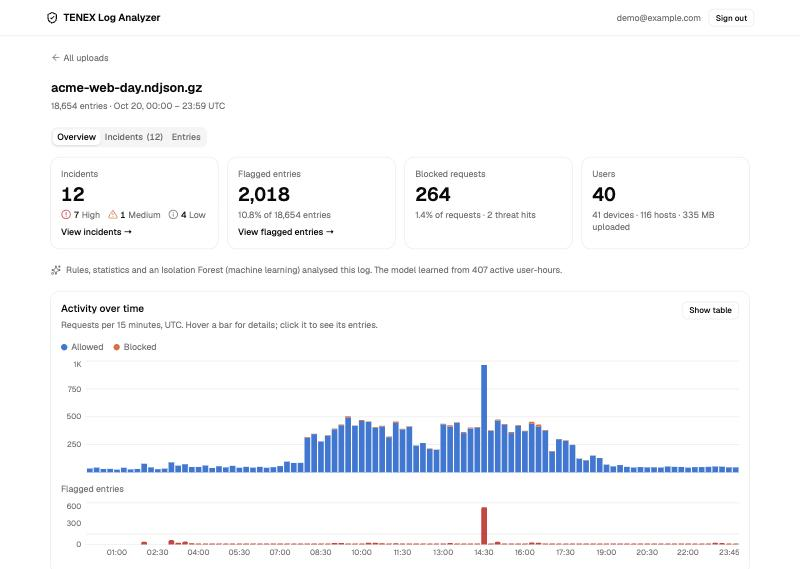
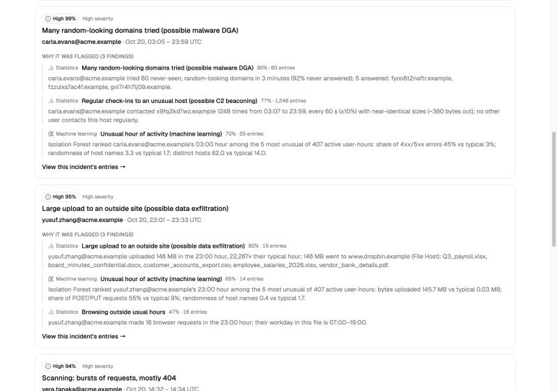
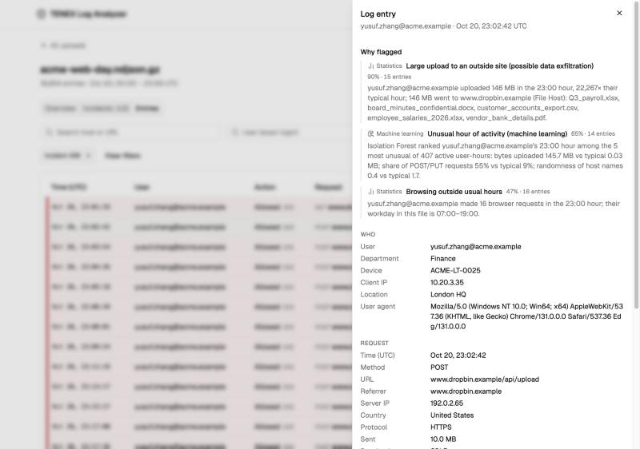
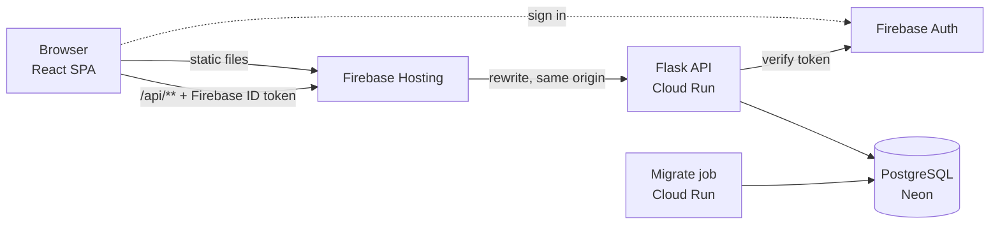

# Proxy Log Analyzer

Upload Zscaler web proxy logs and get what a SOC analyst needs first: a summary and timeline of
the traffic, **incidents ranked by confidence**, and every flagged log line with a plain-English
explanation of **why** it was flagged.

**Live demo:** https://proxy-log-analyzer.web.app (sign-in required) ·
**Run it locally:** `docker compose up --build` ([Quick start](#quick-start))



## Requirements → where to find them

| Requirement | Where |
|---|---|
| Upload and parse Zscaler logs | Uploads page (drag-and-drop or "Try a sample"); parser in [`backend/app/parsing/`](backend/app/parsing/) |
| SOC timeline and summary | Overview tab; stats computed at upload in [`backend/app/stats.py`](backend/app/stats.py) |
| Basic authentication | Firebase email/password, verified on every API request in [`backend/app/auth.py`](backend/app/auth.py) |
| TypeScript React frontend | [`frontend/`](frontend/) (Vite, React 19, TanStack Query, shadcn/ui, Recharts) |
| Flask REST backend | [`backend/app/routes.py`](backend/app/routes.py) (10 endpoints under `/api`) |
| AI-based threat detection | Rules + per-user statistics + an Isolation Forest in [`backend/app/detection/`](backend/app/detection/); write-up in [docs/AI.md](docs/AI.md) |
| PostgreSQL | SQLAlchemy models + Alembic migrations in [`backend/`](backend/); Postgres 18 locally, Neon in production |
| Docker for local runs | [`docker-compose.yml`](docker-compose.yml): database, auth emulator, migrations, API, web |
| **Bonus:** anomaly explanations with confidence scores | Incidents tab and the entry drawer: every finding has a sentence with the numbers and a confidence |
| **Bonus:** cloud deployment | The live demo above; how it's built in [docs/DEPLOY.md](docs/DEPLOY.md) |
| Example logs | [`samples/`](samples/): 3 Zscaler logs with answer keys, plus a non-Zscaler file |
| AI approach | [docs/AI.md](docs/AI.md); measured results in [docs/RESULTS.md](docs/RESULTS.md) |

## Quick start

Needs Docker only. No cloud accounts: sign-in uses a local Firebase Auth emulator.

```bash
docker compose up --build
```

1. Open http://localhost:5173 and sign in with the local demo account from [`.env.example`](.env.example).
2. Click **Full day** under "Try a sample" (or drop your own log).
3. Explore the **Overview**, then **Incidents**, then **Entries**: click a row to see why it was flagged.

| Command | Does |
|---|---|
| `make test` | All tests: backend (pytest against Postgres), frontend (Vitest), sample generator |
| `make lint` | ruff (lint + format) · oxlint · TypeScript |
| `make evaluate` | Re-measures detection against the answer keys → `docs/RESULTS.md` |
| `make samples` | Regenerates the sample logs (byte-identical; seeded) |
| `make reset` | Stops everything and deletes the local database |

## What it does

**1. Upload.** A Zscaler NSS web log as JSON lines (plain or `.gz`, up to 25 MB). The file is
parsed line by line, bad lines are counted and reported rather than failing the upload, and a
file that isn't a Zscaler web log gets a clear error. Uploading the same file twice links to the
existing analysis.

**2. Overview.** Incidents by confidence, flagged entries, blocked requests and users; whether
the machine-learning layer ran; a timeline of allowed / blocked requests with flagged entries
underneath (click a bar to see its entries); top users, uploaders, hosts, block reasons and
threats.



**3. Incidents.** Findings about the same user within 30 minutes, grouped into one incident,
ranked by severity and confidence. Each shows the evidence, strongest first: which kind of
detector found it, a sentence with the actual numbers, and a link to exactly those log lines.

**4. Entries.** The full log, 100 rows per page, filterable by text, user, action, confidence,
time window, incident or finding. Flagged rows are marked with a colour bar *and* a "High 95%"
badge. Clicking a row opens every field and the findings that cover it.



## How detection works

Three layers, 13 detectors, all deterministic Python run once per upload:

1. **Rules:** what Zscaler already marked as bad (named threats, risk scores, phishing and
   malware categories), plus near-certain patterns like a form posted to a phishing page.
2. **Per-user statistics:** behaviour unusual *for that user*, against a baseline learned from
   the same file with the median and MAD (beaconing, large uploads, request bursts, off-hours
   browsing, new devices, random-looking domains).
3. **Isolation Forest:** unsupervised machine learning over one row per user per active hour
   (10 numbers each), catching combinations nobody wrote a rule for, explained by the three
   numbers furthest from typical.

Confidence takes the strongest finding per kind of evidence and combines independent kinds
(noisy-OR), so agreeing detectors raise it. Machine learning alone is capped below High, because
unusual isn't the same as malicious. Details, settings and limitations are in
[docs/AI.md](docs/AI.md).

### Results

Measured against the samples' answer keys ([docs/RESULTS.md](docs/RESULTS.md), checked by a test):

| Sample | Planted attacks caught at High | High incidents that are real | Benign look-alikes reaching High |
|---|---|---|---|
| Full day (18,654 lines, 40 users) | **8 / 8** | **7 / 7** | **0 / 4** |
| Small (1,934 lines) | 3 / 3 | 3 / 3 | 0 / 4 |
| Clean (4,608 lines, no attacks) | — | none | 0 / 4 |

These are synthetic logs from a generator written alongside the detectors, so treat them as an
upper bound (see [Limitations](#limitations-and-next-steps)).

## Architecture



- **Upload request:** parse → pandas DataFrame → stats + detection → one transaction that bulk-inserts
  entries with Postgres `COPY` and stores incidents, findings and precomputed stats. A 20k-line
  file takes about 2 seconds.
- **Reads** are paginated and filtered in SQL; the browser never holds the whole log.
- **Locally** the same API image runs in docker compose with Postgres and the Firebase Auth
  emulator; in production, Firebase Hosting serves the build and forwards `/api` to Cloud Run,
  so there's no CORS. See [docs/DEPLOY.md](docs/DEPLOY.md).

## Sample logs

| File | What's in it |
|---|---|
| [`acme-web-day.ndjson.gz`](samples/acme-web-day.ndjson.gz) | One day, 40 employees, **all 8 planted attacks** (DGA, C2 beaconing, compromised account, phishing, malware download, scanning, policy probing, data exfiltration) and 4 benign look-alikes |
| [`acme-web-small.ndjson`](samples/acme-web-small.ndjson) | 5 employees, 3 attacks; too small for the machine-learning layer |
| [`acme-web-clean.ndjson`](samples/acme-web-clean.ndjson) | Normal traffic and look-alikes only: a false-alarm check |
| [`not-zscaler.log`](samples/not-zscaler.log) | An Apache log, to show the "not a Zscaler web log" error |

Each Zscaler file has a `*.ground_truth.json` answer key; [samples/README.md](samples/README.md)
describes every attack and look-alike. All domains are `.example` and all IPs are
documentation ranges.

## Tests and CI

| Part | Tests | Covers |
|---|---|---|
| Backend | 139 (pytest, real Postgres) | Parser edge cases, stats, every endpoint incl. auth and ownership, each detector, the Isolation Forest, and the evaluation targets |
| Frontend | 83 (Vitest + Testing Library) | Upload flow, URL-driven filters and tabs, incidents, entries, drawer, formatting |
| Samples | 38 (unittest) | Generator determinism and answer keys |

GitHub Actions runs each suite on pull requests that touch its part, and all of them on every push to `main`.

## Security notes

- Every API route except `/api/health` requires a valid Firebase ID token; another user's upload
  returns 404, not 403, so IDs can't be probed.
- Public sign-up is disabled; the API refuses to start in production if the auth-emulator
  setting is present.
- Log content is attacker-controlled: it is only ever rendered as text (no `dangerouslySetInnerHTML`,
  enforced by lint), URLs are never turned into links, and a Content Security Policy restricts
  scripts and connections. No model reads log text, so there's no prompt-injection path.
- Uploads are bounded (25 MB, 50 MB unzipped, 100k lines, gzip-bomb safe) and each user can keep
  10 uploads.
- The only secrets (database URLs) live in Google Secret Manager, readable by one service
  account; nothing secret is in the repository.

## Limitations and next steps

- **Detection was validated on synthetic data** built alongside it; real labelled logs and
  analyst feedback are the next step, then tuning thresholds against them.
- **One file at a time:** baselines are learned per upload; a production version would keep
  per-user history across uploads.
- **Synchronous processing** suits files up to 25 MB; larger files would go through a queue
  (Cloud Tasks) with progress polling.
- **JSON-lines NSS feeds only.** Zscaler feeds can also be CSV or key=value; a field-mapping step
  would accept those.
- **No end-to-end browser tests yet** (flows were checked by hand at each step); Playwright would
  be the next addition.
- **An LLM layer** to summarise incidents and suggest next steps, on top of the structured
  findings with the evidence attached, is a natural extension ([docs/AI.md](docs/AI.md#why-no-llm-at-runtime)).

## More

- [docs/AI.md](docs/AI.md): detection approach in depth, and how AI tools were used to build this
- [docs/RESULTS.md](docs/RESULTS.md): per-attack detection results
- [docs/DECISIONS.md](docs/DECISIONS.md): every design decision and why
- [docs/DEPLOY.md](docs/DEPLOY.md): production setup and cost guardrails
- [docs/ROADMAP.md](docs/ROADMAP.md): how the work was split into milestones
